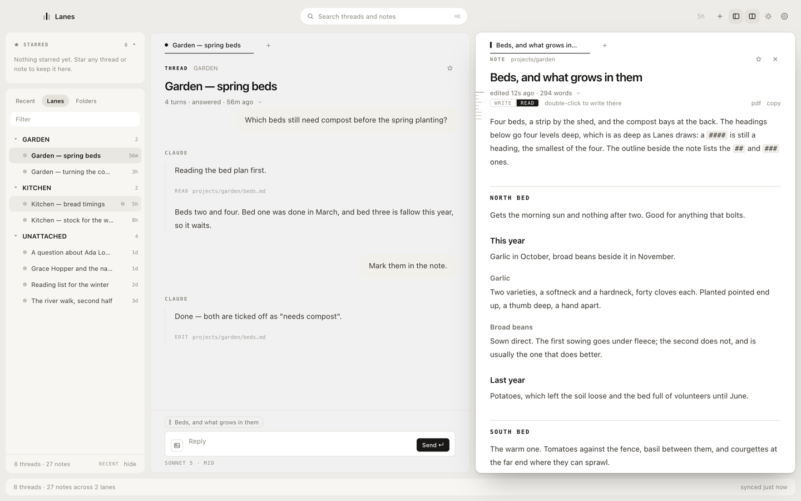

# Lanes

Lanes is a Mac app where your notes and your Claude Code threads sit side by
side. It runs over the Claude Code CLI you already have, and keeps no account,
key or login of its own. Your folder of markdown notes is the working
directory: the notes Claude reads and writes are the ones on the right of the
window, and every session run in that folder is a thread on the left.

<picture>
  <source media="(prefers-color-scheme: dark)" srcset="docs/img/lanes-dark.png">
  
</picture>

## Requirements

- **macOS 12 Monterey or later, on Apple Silicon.**
- **Claude Code, installed and signed in.** Tested with **2.1.285**. Install it
  with `curl -fsSL https://claude.ai/install.sh | bash` (see
  <https://code.claude.com/docs/en/setup>), then run `claude` once in Terminal
  and sign in. Lanes finds `claude` through your login shell's `PATH` and the
  usual install directories; if yours lives elsewhere, set `LANES_CLAUDE` to
  its full path.
- **Node 22.12 or newer**, to build and to run the checks.

## Install from source

From a clone of this repository:

```sh
npm ci
npm run dev       # run it from source
npm run pack      # build dist/mac-arm64/Lanes.app
```

A development run shares its state with an installed Lanes, and only one Lanes
runs per state file: quit the app first, or give the run a state of its own
with `LANES_STATE=/some/dir npm run dev`.

`npm run pack` signs the app with your own code-signing certificate if you have
set one up (`LANES_SIGN_IDENTITY`, or its SHA-1 in `build/.sign-identity`; see
`build/sign.sh`), and ad hoc otherwise — enough for an app that stays on the
Mac that built it, not enough to hand to anyone else. It is not notarised.

`npm run pack` will not write into `~/Library/CloudStorage`, where Dropbox and
other sync clients keep their folders, or into iCloud Drive's. Their file
provider stamps every file with extended attributes and puts them back faster
than they can be stripped, and `codesign` refuses a bundle that carries any.
If your clone lives in one, build somewhere local with
`LANES_BUILD_DIR="$HOME/Library/Caches/lanes-build" npm run pack`; the app is
then `$LANES_BUILD_DIR/mac-arm64/Lanes.app`.

`npm run install-app` builds the same way when the source has changed, and
copies the app into `/Applications`, over any `Lanes.app` already there,
quitting a running Lanes and reopening it; while a turn is running it leaves
the install for the next time it is run, and says so. The copy holds the lock
an update's install takes, so the two never write the app at once.
`build/refresh.sh` has the details, and how to run it as a Claude Code hook
instead.

Optional, and off until you turn it on: `npm run follow -- on <branch>` adds a
git hook that builds each new commit of that branch in a clone outside your
checkout, and Lanes then says **Update ready** at the foot of its rail —
*Restart now*, or it goes in when you quit, if it is known to be newer than
the app. The clone is read from your own repository on disk, but its `npm ci`
downloads packages as any `npm ci` does. `npm run follow -- off` turns it off
and removes all it made; `build/follow.sh` has the rest.

## First run

Before it opens a window, Lanes asks which folder to work in — **Choose a
folder…**, **Use the sample**, or **Quit** — and says "No account, no cloud,
no tracking. Your notes stay in your folder." That is the whole arrangement.
If the folder it had is gone, it asks again, by name.

- **Choose a folder…** takes any folder of markdown notes, or a new one made
  in the picker. Every Claude Code session run in that folder shows up as a
  thread, terminal ones included, for as long as Claude Code keeps its
  transcript under `~/.claude/projects/`: Lanes reads those transcripts.
- **Use the sample** asks where to put it, and copies a small invented vault
  that ships with the app (`fixtures/sample-vault` here) into a new folder
  there called `Lanes Sample`: about thirty notes — a garden, a kitchen, some
  reading, five daily notes — with Ada Lovelace and Grace Hopper as its
  people. It brings two lanes, Garden and Kitchen, and keeps `inbox/` read
  only, unless you already have lanes or read-only folders of your own. Its
  *Start here* note is the guide.

Lanes works on one folder at a time. To change it: Settings (⌘,) → **Notes &
lanes** → *Change…*; Lanes relaunches on the new folder, and asks first if a
turn is running, since the relaunch stops it.

**Lanes are yours, and there are none to begin with** (the sample brings
two). A lane is a name and a folder of your vault, added in the same section
from the vault's top-level folders and the ones a level down; with no lanes
yet, it offers one per top-level folder. A thread is filed in the lane whose
folder holds most of the notes it worked on, a write counting for more than a
read, and when lanes nest the deepest folder wins; a skill named `garden-…`
belongs to a lane called Garden. Nothing assumes a folder layout. Read-only
folders (none by default) and where new notes go (the vault root by default)
are set there too. One convention is built in: notes under `_templates/` are
scaffolding, so two threads that filled in the same template are not counted
as related.

**A new install starts Guarded.** The CLI refuses Claude's writes, commands and
outside calls, and Lanes asks you about each one above the composer. Approving
a file edit lets the rest of that turn edit files; approving a shell command,
or any other tool, runs the rest of that turn with `bypassPermissions` —
everything Claude does until the turn ends, not only the call you saw. The
next turn asks again. **Standard** lets reads and edits run and asks about
commands. **Autonomous** asks once, when you pick it: "Claude runs any command
and edits any file in this folder without asking." Scheduled prompts stay off
until you switch them on in Settings → Prompts; they run while Lanes is open,
even with its window closed, and quitting stops them. A scheduled run is
Autonomous only if you confirmed that prompt as Autonomous, and Standard at
most otherwise.

The keys to start with: **⌘K** finds any thread, note, task or comment, and
makes a new thread or note; **⌘N** makes a note; **⌘T** opens a tab in the pane
you are in; **⌘E** switches a note between reading and writing; **⌘F** finds
in the pane. The rest are in [docs/keys.md](docs/keys.md).

## Two ideas

**The panes have roles.** Threads always open on the left, notes always on the
right. Nothing has to be aimed, and the two kinds can never swap places under
you: where something opens follows what it is, not which pane had focus. A
link to a note in one of Claude's replies opens the note on the right and
leaves the thread where it was. That is one rule — `paneFor` in
`src/renderer/src/state/pane.ts` — and every open goes through it.

**One document engine.** Threads and notes are drawn by the same markdown
parser and the same block components. A thread is a transcript and a note is
a page; the difference is structural, not decorative, so a table or a task in
Claude's answer looks exactly like the same thing in your note. A note has two
states. READ is the page, and nothing on it is a field. WRITE is one editor
with the markdown drawn live, each mark hidden until the caret reaches it — a
surface that takes iA Writer as its reference.

## What it is, what it isn't, what it depends on

- **Is:** a Mac app for working with Claude Code over a folder of markdown
  notes. Threads on the left, notes on the right. Local, quiet,
  keyboard-first.
- **Isn't:** a Claude client with its own account or API key; a sync service;
  an Obsidian replacement or plugin host; cross-platform; a team tool.
- **Depends on:** Claude Code installed and signed in. What you send to Claude
  goes through that CLI to Anthropic, under your account and its terms. Lanes
  reads Claude Code's session files, an internal format that can change; this
  README says which version it was tested with.

Lanes itself makes no network calls. Two things reach further than what you
type, and [PRIVACY.md](PRIVACY.md) has both, with the rest of what Lanes sends
through the CLI: naming a thread the CLI has not named sends the first 600
characters of its opening message and of Claude's first reply to Haiku,
through the same CLI, with the file, shell and web tools denied and from
outside your vault; and the right-click menu on a path in backticks may look
the path up outside your vault, or ask Spotlight for it by name under your
home folder — on your click, metadata only. That menu's *Open* opens folders,
documents and media, and a script as text; anything else is only shown in the
Finder. Token-shaped strings in tool rows are masked on screen while a turn
streams in, and nowhere else. Links leave through one door — web and mail
links to your browser or mail app, a `file:` link to a vault note or the
Finder, anything else refused.
The window cannot navigate away, the renderer is sandboxed, and every
`LANES_*` switch but `LANES_CLAUDE` works only in a development build. More in
[docs/safety.md](docs/safety.md).

State is `lanes-state.json` in `~/Library/Application Support/Lanes/`, beside
two caches Lanes rebuilds when they are gone (`lanes-index.json`,
`lanes-said.json`) and Electron's own files. To uninstall, delete the app and
that folder; your notes and your Claude Code sessions are untouched. If you
turned on `npm run follow`, run `npm run follow -- off` first, which removes
all that following made ([PRIVACY.md](PRIVACY.md) has the list).

## Status

**Early, source-only, v0.1.0.** No signed build to download: you build it
yourself, and it is not notarised. No update check: Lanes asks no server for a
newer version. The one update it offers is a build of your own checkout, and
only while `npm run follow` is on. Mac only, one vault at a time, the Claude
Code CLI and nothing else. What is missing or cut is in
[docs/known-gaps.md](docs/known-gaps.md).

## Docs

- [docs/notes.md](docs/notes.md) — READ and WRITE, the editor, comments
- [docs/threads.md](docs/threads.md) — threads, panes and tabs
- [docs/keys.md](docs/keys.md) — the keyboard, in full
- [docs/search.md](docs/search.md) — ⌘K, ⌘F, and what counts as a match
- [docs/prompts.md](docs/prompts.md) — prompts you keep, and their schedules
- [docs/settings.md](docs/settings.md) — every setting
- [docs/safety.md](docs/safety.md) — Guarded, Standard, Autonomous
- [docs/architecture.md](docs/architecture.md) — where things are, and how
- [docs/known-gaps.md](docs/known-gaps.md) — what is not there yet
- [PRIVACY.md](PRIVACY.md) — what Lanes reads, writes and sends
- [SECURITY.md](SECURITY.md) — how to report a vulnerability
- [CONTRIBUTING.md](CONTRIBUTING.md) — how to propose a change
- [CHANGELOG.md](CHANGELOG.md)
- [LICENSE](LICENSE) — MIT

## Checks

Claims are checked, not asserted: the rule is that a sentence in these docs
that says what the app does has a script in `checks/` that holds the app to
it, proven red before green. `node checks/run.mjs --node` runs the checks on
pure modules. A driven check runs the real app in a world of its own — a
throwaway vault, usually a copy of the sample, and a fresh state under
`/private/tmp`, with a stand-in for the CLI, so nothing is sent or spent:
`--smoke` for the short list, `--all` for all of them, `--dev` to open the app
on such a copy and look, `--self-test` to prove the refusals. `--live` adds the
few that spend real turns. Driven checks take the front window while they run,
and hold with the screen locked; [checks/README.md](checks/README.md) has the
rest.
